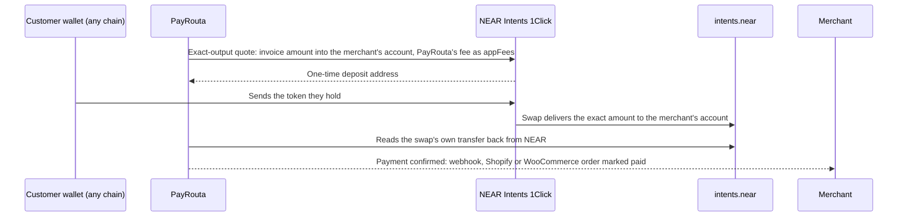

# PayRouta

**Customers pay with any token on any chain. Merchants are paid in the stablecoin, token or local currency they choose. NEAR Intents does the conversion in between.**

PayRouta is a checkout for merchants and AI agents. A store on **Shopify** or **WooCommerce**, a payment link, a button on any site, an SDK call, an MCP tool or a CLI command creates the checkout. The customer pays from whatever they hold: USDT on Tron, ETH on Arbitrum, SOL, NEAR, or a memecoin by its contract address. The merchant receives the exact invoice amount where they chose to be paid, whatever the customer used.

- Live site: [payrouta.com](https://payrouta.com) · Docs: [docs.payrouta.com](https://docs.payrouta.com) · Checkout demo: [payrouta.com/checkout/demo](https://payrouta.com/checkout/demo)
- NEAR HACKATHON tracks: **08 Real-World Money** (primary), **07 Agent Economy**, **04 Autonomous Business**

| The customer pays with | The merchant is paid in |
| --- | --- |
| Any of the 200+ tokens NEAR Intents lists, on 35+ chains | USDC or USDT on the chain they choose (Base, Ethereum, Arbitrum, Polygon, Avalanche, Solana, Stellar), in a NEAR Intents account they own |
| Any other token by contract address: Solana via Jupiter, EVM chains via LI.FI | Any token on any chain, by paying out from that account, gasless |
| A wallet on any EVM chain, Solana or NEAR | Local currency in a bank or mobile money account: USD and EUR through Bridge; NGN, GHS, KES, ZAR, UGX, TZS, ZMW and MXN through Yellow Card |

## Sell on Shopify and WooCommerce

Most merchants already have a store, so PayRouta goes inside it. Both integrations are available today.

**WooCommerce.** The PayRouta Checkout plugin adds PayRouta as a payment method in the block and classic checkouts, with High-Performance Order Storage support. The customer pays on PayRouta, and a signed webhook marks the WooCommerce order paid.
- Download: [payrouta.com/downloads/payrouta-checkout.zip](https://payrouta.com/downloads/payrouta-checkout.zip). Setup guide: [docs/woocommerce](https://payrouta.com/docs/woocommerce)
- Code: [`integrations/woocommerce/payrouta-checkout`](integrations/woocommerce/payrouta-checkout): gateway, Blocks support, API client, webhook handler
- Verified end to end on WordPress 7.1.4 with WooCommerce 11.2.1

**Shopify.** The buyer chooses PayRouta at checkout and pays from a **Pay** button on the Thank you and order status pages. PayRouta marks the order paid through the Admin API once the payment confirms. Unpaid orders are cancelled and restocked after a deadline the merchant sets.
- Setup guide: [docs/shopify](https://payrouta.com/docs/shopify)
- Code: [`integrations/shopify-lite`](integrations/shopify-lite) (checkout UI extension), [`lib/integrations/shopify-lite.ts`](lib/integrations/shopify-lite.ts)
- PayRouta also has a full Shopify payments app ([`integrations/shopify`](integrations/shopify), [`lib/integrations/shopify.ts`](lib/integrations/shopify.ts)), which is in Shopify's partner review.
- Tests: [`tests/shopify-lite.test.ts`](tests/shopify-lite.test.ts), [`tests/shopify.test.ts`](tests/shopify.test.ts) and, with a database, [`tests/treasury/shopify-lite.test.ts`](tests/treasury/shopify-lite.test.ts), which covers "the buyer pays from the Pay button and the order is marked paid"

Other ways in: a payment link to share on WhatsApp or an invoice, one script tag ([`public/js/v1/payrouta.js`](public/js/v1/payrouta.js), [`sdks/checkout`](sdks/checkout)), Node and Python SDKs ([`sdks/node`](sdks/node), [`sdks/python`](sdks/python)), an MCP server and the `payrouta` CLI.

## How a payment settles through NEAR Intents



1. **The merchant owns the account.** They connect a NEAR Intents account by signing a message in their own wallet: NEP-413 for NEAR accounts, ERC-191 for EVM addresses, raw Ed25519 for Solana. A merchant with no wallet can create one by signing in with Google, Apple, X or email, and owns its key. PayRouta never holds the keys or the funds. ([`lib/intents/signing.ts`](lib/intents/signing.ts), [`lib/intents/account.ts`](lib/intents/account.ts), [`lib/intents/near.ts`](lib/intents/near.ts))
2. **Exact-output quotes.** PayRouta asks 1Click for a quote that delivers exactly the invoice amount, so the merchant never absorbs swap costs or slippage. If the swap fails, NEAR Intents refunds the customer on their own chain. ([`lib/intents/oneclick.ts`](lib/intents/oneclick.ts), [`lib/intents/checkout.ts`](lib/intents/checkout.ts))
3. **Confirmation comes from the chain.** 1Click reporting success is not enough. PayRouta reads the swap's NEAR transactions and confirms only a final `intents.near` transfer of exactly that amount into the merchant's account, made by one of that swap's own intents. Each transfer can confirm one payment only. ([`lib/providers/adapters/native/near-intents-deposit.ts`](lib/providers/adapters/native/near-intents-deposit.ts))
4. **The fee is taken at source.** PayRouta's 1.5% is collected in the same swap through 1Click `appFees`, so there are no invoices to chase. This is the business model, and it works from the first payment.
5. **Payouts and refunds to any chain, gasless.** From the same balance, the merchant pays suppliers or refunds customers in any token on any chain by signing one intent. Before the wallet signs, PayRouta checks that the intent moves exactly the quoted amount to the quote's deposit account and nothing else. ([`lib/intents/payouts.ts`](lib/intents/payouts.ts))
6. **Settle in a bank.** With bank settlement on, each quote delivers USDC on Base straight to the merchant's Bridge liquidation address or to PayRouta's Yellow Card balance. The payment confirms on the finalized Base transfer, then a bank or mobile money payout follows. ([`lib/providers/adapters/native/near-intents-offramp.ts`](lib/providers/adapters/native/near-intents-offramp.ts), [`lib/treasury/offramp`](lib/treasury/offramp))
7. **Tokens NEAR Intents doesn't list.** A customer can paste any token's contract address. The token is swapped into USDC in their own wallet first, and the payment succeeds only if that swap delivers at least the payment amount. ([`lib/intents/dex.ts`](lib/intents/dex.ts))

Full guide: [docs/near-intents](https://payrouta.com/docs/near-intents) and [`content/docs/near-intents.md`](content/docs/near-intents.md).

## Payments by and for AI agents

- **Agents pay over HTTP.** `GET /api/agent/v1/links/{id}` answers `402 Payment Required` with the amount and the ways to pay. An agent pays from its wallet, or signs one transfer from its NEAR Intents balance. ([`app/api/agent/v1`](app/api/agent/v1), [docs/agents](https://payrouta.com/docs/agents))
- **Agent keys with limits.** A business gives an agent a key with a daily, weekly or monthly budget, a per-payment cap and an optional merchant allow-list. PayRouta checks every payment against them before preparing it.
- **MCP server** at `/api/mcp` ([`lib/mcp`](lib/mcp)). Merchant tools: `create_checkout`, `create_payment_link`, `list_payments`, `refund_payment`, `create_plan`, `create_subscription`, `record_usage` and more. Buyer tools for agent keys: `get_payment_terms`, `open_checkout`, `pay_checkout`, `submit_signed_intent`, `get_spending`.
- **`payrouta` CLI** ([`sdks/cli`](sdks/cli)): a zero-dependency client of the MCP server for terminals, scripts and CI.
- **Subscriptions.** Plans and usage meters. Each invoice can be paid from any wallet, including by an agent over MCP.

## Check it yourself

Node 24. These need no database and no API keys:

```sh
npm ci                      # also generates the Prisma client
npm test                    # 759 unit tests: NEAR Intents, 1Click, signatures, Shopify, agents, MCP, CLI, fees
npm run typecheck
npm run lint
npm run test:sdk-python
npm run build --prefix sdks/cli
```

With a local PostgreSQL 17 (`npm run portal:db` uses Homebrew's `postgresql@17`), the end-to-end suites run against a fake 1Click API and simulated providers:

```sh
npm run portal:env && npm run portal:db && npm run db:migrate
npm run test:intents        # cross-chain checkouts, NEAR Intents settlement, DEX tokens, agent payments from an intents balance
npm run test:agents         # 402 terms, agent keys and budgets, MCP for merchants and buyers
npm run test:treasury       # Shopify, payment links, subscriptions, bank cash-out
npm run test:payments && npm run test:merchant && npm run test:partners && npm run test:email
```

### Where each claim is tested

| Claim | Code | Test |
| --- | --- | --- |
| A Base USDC invoice is paid with Tron USDT and the merchant receives the exact amount | `lib/intents/checkout.ts` | `tests/intents/database.test.ts`: "cross-chain: a customer pays a Base USDC invoice with Tron USDT…" |
| Quotes are exact-output and refund on the customer's chain | `lib/intents/oneclick.ts` | `tests/intents.test.ts`: "quotes ask for an exact-output swap…" |
| Confirmation only after the swap's own delivery is final on NEAR, claimed once | `near-intents-deposit.ts` | `tests/near-intents.test.ts`: "the adapter confirms only after the swap's delivery is final on NEAR, and claims it once" |
| Batched settlements count only this swap's transfers | `near-intents-deposit.ts` | `tests/near-intents.test.ts`: "deliveries count only the swap's own transfers…" |
| The fee is withheld at source and the payment still confirms in full | `lib/intents/oneclick.ts` | `tests/near-intents.test.ts`: "with PayRouta's fee withheld at source…" |
| NEAR, EVM and Solana wallets own the account | `lib/intents/signing.ts` | `tests/near-intents.test.ts`: NEP-413, ERC-191 and Solana tests |
| A payout signs exactly the quoted transfer and nothing else | `lib/intents/payouts.ts` | `tests/near-intents.test.ts`: "a payout's funding intent must be exactly the quoted transfer…" |
| Settled to a bank only on the swap's finalized USDC transfer | `near-intents-offramp.ts` | `tests/near-intents.test.ts`: "settled straight to the bank…" |
| Any token by contract address, with the swap before the payment | `lib/intents/dex.ts` | `tests/intents/database.test.ts`: "dex: …" (3 tests) |
| Shopify order marked paid after the Pay button; unpaid orders cancelled | `lib/integrations/shopify-lite.ts` | `tests/treasury/shopify-lite.test.ts` |
| Agents get 402 terms and are held to their key's budget | `app/api/agent/v1`, `lib/agents` | `tests/agents/database.test.ts`, `tests/agents.test.ts` |
| An agent pays from its NEAR Intents balance by signing one transfer | `lib/intents` | `tests/intents/database.test.ts`: "near intents: an agent pays from its intents balance…" |
| MCP tools and CLI | `lib/mcp`, `sdks/cli` | `tests/agents/database.test.ts`, `tests/cli.test.ts` |

1Click has no testnet, so NEAR Intents settlement runs on mainnet, on live checkouts. The tests use fake 1Click and NEAR RPC answers in the shapes the real APIs return.

## Run the app locally

```sh
npm ci
npm run portal:env        # writes .env for local mode and a vault key outside the repo
npm run portal:db         # starts PostgreSQL on 127.0.0.1:55432
npm run db:migrate
npm run db:seed           # fictional users (owner@harbor.example / PayRouta-Local-2026!)
npm run payments:seed     # fictional merchant and simulated providers
npm run portal:worker     # terminal 2
npm run dev               # http://127.0.0.1:3000
```

Local mode uses fictional data only. Mail is captured to `.local/portal/mail` (viewer at `/provider/dev-mail`), and the demo authenticator code `123456` works. Never run local mode on a public host.

## Beyond crypto

The same checkout takes cards, digital wallets, bank transfers, mobile money, USSD and credit from licensed lenders, through regulated processing partners. PayRouta works as an aggregator ([`docs/AGGREGATOR.md`](docs/AGGREGATOR.md)): merchants apply once, PayRouta opens their sub-accounts with partners by API, and it routes each payment to a partner that can take it, with a backup for the same method. These methods work end to end in the sandbox and go live partner by partner, region by region. Stablecoin and crypto payments are live today. Thesis and status by pillar: [`docs/THESIS.md`](docs/THESIS.md).

## Repository map

| Area | Path |
| --- | --- |
| NEAR Intents: quotes, checkout, settlement, payouts, DEX tokens, coverage | `lib/intents`, `lib/providers/adapters/native/near-intents-*.ts` |
| Shopify and WooCommerce | `integrations/`, `lib/integrations`, `app/api/integrations/shopify` |
| Agent API, MCP server, CLI | `app/api/agent/v1`, `lib/mcp`, `app/api/mcp`, `sdks/cli` |
| Checkout pages, button and universal checkout | `app/checkout`, `public/js/v1/payrouta.js`, `sdks/checkout`, `lib/payments/universal.ts` |
| Payments: intents, routing, execution, reconciliation, merchant API | `lib/payments`, `app/api/v1` |
| Bank and mobile money cash-out (Bridge, Yellow Card) | `lib/treasury/offramp` |
| Merchant dashboard | `app/merchant`, `lib/merchant` |
| Credit at checkout | `lib/treasury/credit.ts`, `lib/treasury/credit-checkout.ts` |
| Provider portal and operations console | `app/provider`, `lib/portal`, `lib/providers`, `app/ops` |
| Background worker | `scripts/worker.ts`, `lib/portal/worker.ts` |
| SDKs | `sdks/node`, `sdks/python`, `sdks/checkout` |
| Marketing site and public docs | `app/page.tsx`, `app/[...path]`, `components/marketing`, `content/`, `mintlify/` |

## Documentation

- Developer docs: [docs.payrouta.com](https://docs.payrouta.com), from [`mintlify/`](mintlify) and [`content/docs`](content/docs)
- NEAR Intents: [`content/docs/near-intents.md`](content/docs/near-intents.md), [`content/docs/cross-chain.md`](content/docs/cross-chain.md)
- Shopify and WooCommerce: [`content/docs/shopify.md`](content/docs/shopify.md), [`content/docs/woocommerce.md`](content/docs/woocommerce.md)
- Agents, MCP, CLI: [`content/docs/agents.md`](content/docs/agents.md), [`content/docs/mcp.md`](content/docs/mcp.md), [`content/docs/cli.md`](content/docs/cli.md)
- Production runbook: [`docs/PRODUCTION.md`](docs/PRODUCTION.md); payments internals: [`docs/PAYMENTS.md`](docs/PAYMENTS.md); fees: [`docs/PLATFORM-BILLING.md`](docs/PLATFORM-BILLING.md)
