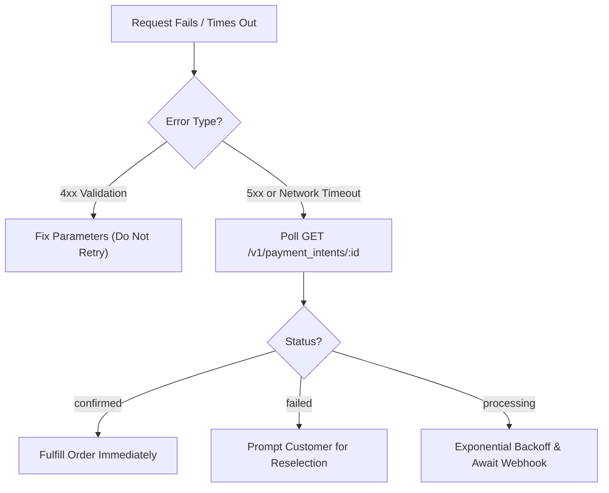

# Errors & Recovery

Errors should explain precisely which stage of the transaction failed without conflating availability, execution, and settlement. 

> [!IMPORTANT]
> A lost network connection or timeout after payment initiation does not mean payment failed. Blindly retrying can cause double charges. Always check authoritative status before initiating a new charge.

---

## Error taxonomy

| Error Code | Category | Cause | Recommended Action |
| :--- | :--- | :--- | :--- |
| `invalid_intent_request` | Validation | Missing required fields, bad currency, or invalid decimals. | Fix request parameters; do not retry identical payload. |
| `method_unavailable` | Availability | Requested rail cannot serve this corridor, amount, or device. | Display remaining viable rails for customer reselection. |
| `provider_degraded` | Routing | Primary route experiencing elevated errors before execution. | Engine auto-fails over to secondary route within same method. |
| `provider_declined` | Execution | Insufficient funds, incorrect PIN, or customer card rejected. | Show human-readable reason; prompt customer to try another method. |
| `execution_timeout` | Uncertainty | Upstream clearing network delayed response after initiation. | **Do not re-attempt.** Poll `GET /v1/payment_intents/:id` or await webhook. |
| `settlement_delayed` | Treasury | Banking cutoff or temporary liquidity constraint. | Order fulfillment proceeds; treasury monitors payout status. |

---

## Error response format

All error responses return standard JSON with an `error` envelope:

```json
{
  "error": {
    "code": "method_unavailable",
    "message": "Instant bank transfer is unavailable for this corridor and ticket size.",
    "param": "accepted_methods",
    "details": {
      "method_id": "bank_transfer",
      "reason": "exceeds_corridor_limit",
      "max_limit": "500000.00",
      "currency": "NGN"
    },
    "doc_url": "https://docs.payrouta.com/payment-methods"
  }
}
```

---

## Handling specific edge cases

### 1. Provider unavailable before initiation
If a primary banking or card provider becomes degraded *before* customer authorization begins:
* PayRouta's engine automatically selects the secondary direct provider for that same method.
* If all eligible providers for that method are depleted, PayRouta returns `method_unavailable`.
* **Prompt the customer for a fresh selection**. Never silently switch from bank transfer to credit card.

### 2. Uncertain execution and timeouts
If an API request times out while waiting for upstream network confirmation:
1. Preserve your `merchant_reference` and `Idempotency-Key`.
2. Do not immediately ask the customer to re-enter payment details.
3. Call `GET /v1/payment_intents/:id` with exponential backoff (e.g., 2s, 4s, 8s).
4. If status transitions to `confirmed`, proceed with fulfillment.
5. If status transitions to `failed`, prompt customer for retry.

### 3. Settlement pending is not transaction failure
Payment authorization and merchant settlement occur on separate timelines. If customer pay-in is confirmed (`payment.confirmed`), the buyer's obligation is complete:
* Fulfill the order immediately.
* Do not cancel or reverse customer purchases because bank batch settlement is scheduled for the next business morning.

---

## Safe retry guidance



---

## Next steps

* Review webhook reconciliation in [Webhooks & Events](webhooks.md).
* Review payment intent requirements in [Payment Intents](payment-intents.md).
* Explore API endpoints in [API Reference](api-reference.md).
