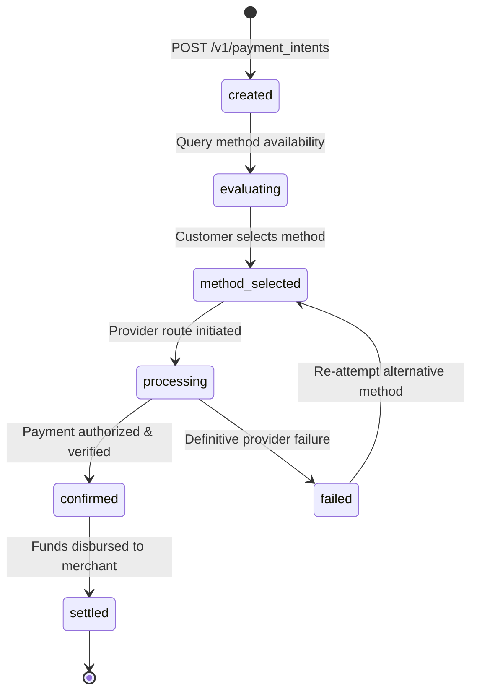

# Payment Intents

A Payment Intent encapsulates the commercial requirements of a transaction before provider selection and payment execution. It decouples the merchant's business terms from customer checkout choices and provider routing.

> [!IMPORTANT]
> Creating a Payment Intent does not initiate funds movement or charge the customer. It establishes the constraints required to evaluate real-time method availability.

---

## The Payment Intent lifecycle



* **`created`**: The merchant intent is registered with invoice details.
* **`evaluating`**: Dynamic availability engine evaluates viable payment rails.
* **`method_selected`**: The customer explicitly selects their payment rail and direct institution.
* **`processing`**: PayRouta executes through the optimal direct provider route.
* **`confirmed`**: The buyer's payment is verified and cleared. The merchant can safely fulfill orders.
* **`settled`**: Funds are transferred into the merchant's chosen settlement destination.

---

## Request schema

```json
{
  "amount": "1200.00",
  "currency": "USD",
  "settlement": {
    "currency": "USD",
    "target_instrument": "circle_usdc",
    "network": "avalanche"
  },
  "accepted_methods": [
    "instant_bank",
    "digital_wallet",
    "card",
    "direct_debit",
    "cash_voucher",
    "bnpl",
    "mobile_money",
    "stablecoins",
    "crypto_app",
    "rwa"
  ],
  "payer_context": {
    "country": "BR",
    "ip_address": "177.136.241.10",
    "preferred_locale": "pt-BR"
  },
  "merchant_reference": "inv_global_99201",
  "expires_in_seconds": 1800
}
```

### Schema field reference

| Field | Type | Required | Description |
| :--- | :--- | :--- | :--- |
| `amount` | string | Yes | The exact invoice total as a decimal string to guarantee precision. |
| `currency` | string | Yes | ISO 4217 three-letter currency code (e.g., `USD`, `NGN`, `BRL`, `EUR`). |
| `settlement` | object | Yes | Merchant's preferred settlement method and destination network. |
| `settlement.currency` | string | Yes | The currency or asset requested for merchant payout. |
| `settlement.target_instrument` | string | Yes | Payout rail: `local_bank`, `multi_currency`, `circle_usdc`, `binance_pay`, or `ondo_usdy`. |
| `settlement.network` | string | No | Required for stablecoin/RWA settlement (e.g., `avalanche`, `base`, `solana`). |
| `accepted_methods` | array | Yes | List of allowed payment rails for this transaction. |
| `payer_context` | object | Yes | Payer metadata used for real-time corridor evaluation. |
| `merchant_reference` | string | Yes | Unique idempotency and reconciliation identifier from merchant's system. |
| `expires_in_seconds` | number | No | Intent validity duration (default: 1800 seconds). |

---

## Payer context vs. hard-coded rules

Payer geolocation is an input to availability, not a static constraint:
* A buyer located in Brazil (`BR`) checking out on a US site can pay via **Pix** (instant bank), domestic **Elo** card, or **Circle USDC**.
* A buyer in Nigeria (`NG`) can pay via **NIP** bank transfer, **Bank USSD** (`*737#`), **OPay** wallet, or **MTN MoMo**.
* Never hard-code geographic lookup tables on the frontend. The backend availability engine factors in real-time liquidity, transaction limits, and regulatory status.

---

## Invalidation and idempotency

* **Idempotency Keys**: Send an `Idempotency-Key` header with all `POST` requests. Re-transmitting the same intent request with the same idempotency key returns the existing intent without creating a duplicate.
* **Intent Mutation**: If cart contents, invoice total, or settlement preferences change, invalidate the existing intent and create a new intent. Never execute a payment against a stale total.

---

## Next steps

* Explore available payment rails in [Payment Methods & Channels](payment-methods.md).
* Review merchant treasury options in [Settlement & Treasury](settlement.md).
* Review full REST endpoints in [API Reference](api-reference.md).
