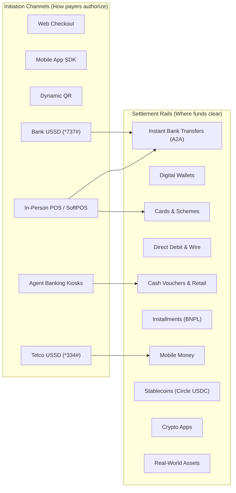

# Payment Methods & Initiation Channels

Availability determines whether a payment rail can serve a transaction right now. It is computed before customer selection and provider routing.

> [!TIP]
> PayRouta distinguishes between the **Settlement Rail** (how funds clear and settle) and the **Initiation Channel** (how the customer authorizes the transaction, such as online, via offline USSD, or at an in-person POS terminal).

---

## Inputs to availability

Availability is evaluated dynamically using multiple inputs:
* **Payer Context**: Geolocation, country of residence, currency, device capabilities.
* **Merchant Profile**: Business entity jurisdiction, accepted methods, settlement preferences.
* **Transaction Limits**: Minimum and maximum ticket sizes per rail.
* **Regulatory & Compliance**: KYC/AML rules, local scheme regulations, sanctions screening.
* **Provider Operating Health**: Real-time provider latency, error rates, maintenance windows, and available liquidity.

---

## The 10 core settlement rails

PayRouta classifies payment methods into 10 fundamental global clearing rails:

### 1. Instant Bank Transfers (A2A)
Real-time account-to-account bank transfer networks move funds directly between bank accounts within seconds.
* **Global Systems**: **Pix** (Brazil), **UPI** (India), **iDEAL / Wero** (Europe), **FedNow / RTP** (US), **Faster Payments FPS** (UK), **NIP** (Nigeria), **BLIK** (Poland), **SPEI** (Mexico), **PayNow** (Singapore), **PromptPay** (Thailand).
* **Initiation Channels**: Online banking redirect, dynamic QR code scanning, and offline **Bank USSD shortcodes** (e.g., `*737#` for GTBank, `*966#` for Zenith Bank) enabling feature-phone users to authorize interbank transfers without internet connectivity.

### 2. Digital Wallets
Stored-value and aggregated payment wallets enabling instant one-tap or QR-based checkout.
* **Global Systems**: **Apple Pay**, **Google Pay**, **PayPal**, **Cash App**, **Venmo** (North America / Europe); **OPay**, **PalmPay** (West Africa); **Alipay**, **WeChat Pay** (China); **PayPay** (Japan); **Mercado Pago** (Latin America); **GCash** (Philippines).
* **Initiation Channels**: Native mobile OS biometric sheet (Face ID / Touch ID), browser extension, dynamic QR code.

### 3. Domestic & International Card Networks
Debit, credit, and prepaid card schemes spanning international card brands and regional domestic schemes.
* **Global Systems**: **Visa**, **Mastercard**, **American Express**, **Discover** alongside domestic schemes with superior local authorization rates: **RuPay** (India), **Cartes Bancaires (CB)** (France), **UnionPay** (China), **Elo** (Brazil), **JCB** (Japan), **Verve** (Nigeria / West Africa), **Mada** (Saudi Arabia), **Troy** (Turkey).
* **Initiation Channels**: Online checkout (Card-Not-Present), in-person **Point-of-Sale (POS) terminals**, mobile POS (mPOS), and **SoftPOS (Tap-to-Phone)**.

### 4. Direct Debit & Wire Transfers
Batch bank clearing and electronic fund transfers suited for recurring subscriptions, payroll, utility bills, and large enterprise B2B invoices.
* **Global Systems**: **ACH Direct Debit** (US), **SEPA Direct Debit (SDD)** (Eurozone), **Bacs** (UK), **PADs** (Canada), **BECS** (Australia), **Fedwire**, **SWIFT**.
* **Settlement Timing**: Clears along standard commercial banking schedules over 1 to 3 business days.

### 5. Cash Vouchers & Retail Payments
Cash collection networks and retail vouchers allowing customers to initiate digital orders online and complete payment in cash.
* **Global Systems**: **OXXO Pay** (Mexico), **Boleto Bancário** (Brazil), **Konbini** (Japan: 7-Eleven, Lawson, FamilyMart), **Multibanco** (Portugal), **Pago Fácil / Rapipago** (Argentina), **Paysafecard** (Europe).
* **Agent Banking POS Channels**: Neighborhood agency banking networks (such as **Moniepoint**, **Baxi**, **Paga**, and **Equity Agent POS**) where customers tender physical cash at neighborhood agent counters to settle digital transactions.

### 6. Buy Now, Pay Later (BNPL) & Local Installments
Point-of-sale financing and consumer installment credit. The merchant receives full upfront settlement, while the financing provider handles consumer installment risk.
* **Global Systems**: **Klarna** (Europe / US), **Affirm** (US), **Afterpay / Clearpay** (Australia / US / UK), **Tabby**, **Tamara** (Middle East), and Latin American card installments (*Parcelamento* in Brazil, *Meses sin intereses* in Mexico, *Cuotas* in Argentina).

### 7. Mobile Money & Carrier Billing
Telecom-stored balances and mobile phone billing systems widely adopted in emerging markets where mobile phones outnumber traditional bank accounts.
* **Global Systems**: **Safaricom M-Pesa** (East Africa), **MTN MoMo** (Sub-Saharan Africa), **Airtel Money**, **Orange Money**, **Direct Carrier Billing** (Boku, Fortumo, Centili).
* **Initiation Channels**: SIM Toolkit (STK Push) prompts and offline **Telco USSD sessions** (e.g., `*334#` for M-Pesa, `*671#` for MoMo) requiring zero internet connectivity.

### 8. Stablecoins
Regulated, dollar-backed digital currency tokens for instant, 24/7 global cross-border settlement.
* **Supported Assets & Networks**: **Circle USDC** across high-throughput blockchains including **Avalanche (C-Chain)**, **Base**, **Solana**, **Ethereum**, **Polygon PoS**, and **Arbitrum One**; **Circle EURC** for MiCA-compliant Euro liquidity.
* **Clearing Speed**: Sub-second to few-second finality with low fixed network fees. Settle directly to corporate crypto wallets or convert automatically to fiat bank accounts.

### 9. Crypto Apps & Exchange Checkouts
Direct checkout integrations with major cryptocurrency exchange balances and crypto apps.
* **Global Systems**: **Binance Pay**, **Coinbase Commerce**, **Gate Pay**, **OKX Pay**, **Crypto.com Pay**.
* **Initiation Channels**: In-app authorization and dynamic QR scanning. Payments clear instantly off-chain within the exchange ecosystem without blockchain network gas fees.

### 10. Real-World Assets (RWAs)
Tokenized traditional financial instruments and yield-bearing cash equivalents on public blockchains.
* **Supported Assets**: Short-term tokenized US Treasury bills and yield notes (**Ondo Finance USDY / OUSG**, **Franklin Templeton BENJI**), tokenized physical gold (**Paxos Gold PAXG**), and tokenized sovereign debt notes.
* **Use Cases**: Buyers check out using eligible tokenized RWAs, and merchants can elect to receive settlement directly in yield-generating notes.

---

## Initiation channels vs. settlement rails

PayRouta cleanly separates the **settlement rail** from the **initiation channel**:

* **Bank USSD** (`*737#`, `*966#`) operates under **Instant Bank Transfers (A2A)**: Enables feature-phone users to authorize interbank transfers offline.
* **Telco USSD & STK Push** (`*334#`, `*671#`) operates under **Mobile Money**: Debits telecom wallet balances directly on low-connectivity devices.
* **In-Person POS Terminals & SoftPOS** operate under **Card Schemes** and **Instant Bank Transfers**: Bridges physical retail checkouts with automated digital routing.
* **Agent POS Cash Tender** operates under **Cash Vouchers & Retail Payments**: Confirms payments when cash is handed to verified neighborhood agents (Moniepoint, Baxi, Paga, OXXO).

---

## Availability states

| State | Definition | Customer Presentation |
| :--- | :--- | :--- |
| **Available** | At least one eligible provider path satisfies requirements. | Displayed as selectable option. |
| **Unavailable** | No provider currently satisfies the transaction corridor. | Hidden or grayed out with clear explanation. |
| **Degraded** | Rail is operational but experiencing elevated latency or reduced SLA. | Offered with performance notice or routed via secondary path. |
| **Restricted** | Regulatory, ticket-size, or merchant policy constraint applies. | Ineligible for selection with specific reason. |

---

## Customer selection guardrails

1. **Explicit Choice**: Accepted payment methods are merchant preferences, not an assumption that every method is viable. Always allow the customer to choose from viable options.
2. **Strict Route Comparison**: A bank transfer choice compares eligible banks and banking gateways. A card choice compares domestic and international acquirers. Lower fees on another rail never permit overriding customer selection.
3. **Reselection on Depletion**: If all eligible providers for a chosen rail fail prior to execution, request customer reselection rather than silently executing on a different rail.

---

## Next steps

* Learn how to specify accepted methods in [Payment Intents](payment-intents.md).
* Explore merchant payout options in [Settlement & Treasury](settlement.md).
* Review API parameters in [API Reference](api-reference.md).
