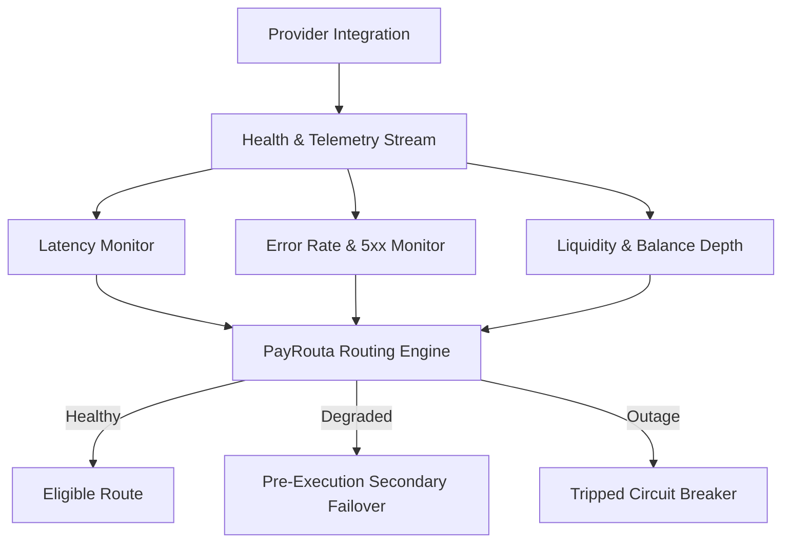

# Provider Integration

Providers contribute execution and liquidity capabilities to the PayRouta routing network. Participants include commercial banks, card acquirers, mobile money operators, crypto exchange checkouts, and tokenized asset issuers.

> [!NOTE]
> Participation in the PayRouta provider network begins with technical evaluation, capability review, and sandboxed pilot execution. Never transmit production credentials, private keys, or compliance documents over public channels.

---

## Provider capability manifest

Providers declare their operational footprint through a structured capability manifest evaluated by the routing engine:

```json
{
  "provider_id": "prov_global_clearing_core",
  "name": "Global Clearing Core",
  "category": "acquirer_and_banking",
  "methods": [
    "instant_bank",
    "digital_wallet",
    "card",
    "direct_debit",
    "cash_voucher",
    "bnpl",
    "mobile_money",
    "stablecoins",
    "crypto_app",
    "rwa"
  ],
  "supported_corridors": [
    {
      "country": "NG",
      "currency": "NGN",
      "methods": ["instant_bank", "mobile_money", "cash_voucher"],
      "channels": ["web", "mobile_app", "ussd", "agent_pos"],
      "min_amount": "100.00",
      "max_amount": "5000000.00",
      "typical_latency_ms": 450
    },
    {
      "country": "BR",
      "currency": "BRL",
      "methods": ["instant_bank", "card", "cash_voucher"],
      "channels": ["pix_qr", "pos_terminal"],
      "min_amount": "1.00",
      "max_amount": "100000.00",
      "typical_latency_ms": 250
    }
  ],
  "settlement_directions": [
    {
      "operation": "pay_in",
      "accepted_assets": ["NGN", "BRL", "USD", "EUR", "KES"]
    },
    {
      "operation": "payout",
      "target_instruments": ["local_bank", "multi_currency", "circle_usdc", "binance_pay", "ondo_usdy"]
    }
  ]
}
```

---

## Directional asymmetry

Processing capability is rarely symmetric:
* A provider supporting **Circle USDC $\rightarrow$ NGN** bank conversion does not automatically support **NGN $\rightarrow$ USDC**.
* Conversion corridors, regulatory licenses, and liquidity reserves must be declared and validated separately for pay-in and payout directions.

---

## Dynamic health & telemetry signals

PayRouta's smart routing engine continuously monitors telemetry from connected providers:



* **Latency thresholds**: Providers exceeding 2,500ms authorization latency are ranked lower in "Faster" routing policies.
* **Error spike circuit breakers**: If consecutive failures exceed predefined thresholds, traffic temporarily shifts to secondary providers.
* **Liquidity depth**: Providers clearing high-value stablecoin or fiat payouts publish real-time liquidity pools to prevent execution rejections.

---

## Safe pilot and onboarding sequence

1. **Capability Manifest Declaration**: Define supported rails, currencies, limits, and regional licenses.
2. **Sandbox Validation**: Test positive authorizations, customer declines, network timeouts, and webhook idempotency.
3. **Shadow Mode**: Evaluate latency and availability against synthetic test traffic.
4. **Scoped Pilot**: Route a small percentage of live volume in low-risk corridors.
5. **Full Network Availability**: Provider becomes eligible for production optimization across Balanced, Lower Cost, and Faster policies.

---

## Next steps

* Explore available payment rails in [Payment Methods & Channels](payment-methods.md).
* Review treasury payout options in [Settlement & Treasury](settlement.md).
* Submit an enquiry through the [Provider Contact Channel](/contact?intent=provider).
