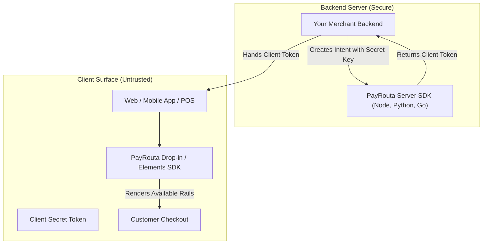

# SDKs & Client Libraries

PayRouta provides server-side libraries and lightweight client checkout SDKs to simplify integration across web, mobile, and in-person environments.

> [!WARNING]
> **Security boundary**: Never embed server secret keys (`sec_key_...`) in frontend or mobile applications. Client SDKs only accept restricted publishable keys (`pub_key_...`) or client tokens scoped to a single payment intent.

---

## SDK architecture



---

## Planned official SDKs

### Server-side libraries
* **Node.js / TypeScript**: `@payrouta/node`
* **Python**: `payrouta-python`
* **Go**: `github.com/payrouta/payrouta-go`
* **Java / Kotlin**: `com.payrouta.sdk`

### Client-side libraries
* **Web Drop-in**: `@payrouta/checkout-web` (Vanilla JS, React, Vue, Next.js)
* **iOS SDK**: `PayRoutaKit` (Swift / SwiftUI)
* **Android SDK**: `com.payrouta.android` (Kotlin / Jetpack Compose)
* **React Native / Flutter**: `@payrouta/react-native`, `payrouta_flutter`

---

## Server SDK example (TypeScript / Node.js)

```typescript
import { PayRouta } from "@payrouta/node";

const payrouta = new PayRouta({
  apiKey: process.env.PAYROUTA_SECRET_KEY!,
});

// Create intent on server
const intent = await payrouta.paymentIntents.create({
  amount: "15000.00",
  currency: "NGN",
  acceptedMethods: ["bank_transfer", "digital_wallet", "stablecoins"],
  settlement: {
    currency: "USD",
    targetInstrument: "circle_usdc",
    network: "avalanche",
  },
  payerContext: {
    country: "NG",
  },
});

// Pass intent.clientSecret to your client
console.log("Client secret:", intent.clientSecret);
```

---

## Client Web Drop-in example (React)

```tsx
import { PayRoutaProvider, PaymentElement, usePayRouta } from "@payrouta/react";

export function CheckoutPage({ clientSecret }: { clientSecret: string }) {
  return (
    <PayRoutaProvider clientSecret={clientSecret}>
      <CheckoutForm />
    </PayRoutaProvider>
  );
}

function CheckoutForm() {
  const { payrouta, isReady } = usePayRouta();

  const handleSubmit = async (e: React.FormEvent) => {
    e.preventDefault();
    if (!payrouta) return;

    const { error, payment } = await payrouta.confirmPayment({
      returnUrl: "https://yourmerchant.com/order/complete",
    });

    if (error) {
      console.error("Payment failed:", error.message);
    }
  };

  return (
    <form onSubmit={handleSubmit}>
      {/* Renders dynamic available methods (Bank, Wallets, Cards, USSD) */}
      <PaymentElement />
      <button type="submit" disabled={!isReady}>
        Pay Now
      </button>
    </form>
  );
}
```

---

## Handling omnichannel form factors

PayRouta client SDKs natively handle dynamic interaction states:
* **QR Codes**: Renders high-resolution vector QR codes for Pix, UPI, and crypto checkouts with auto-copy and direct bank deep-links.
* **USSD Prompts**: For offline or feature-phone flows, renders click-to-dial strings (e.g., `tel:*737*...`) on mobile devices.
* **Biometric Wallets**: Opens Apple Pay / Google Pay system sheets with single-tap Face ID / Touch ID validation.
* **POS Terminal Webhooks**: Displays real-time polling or WebSocket updates when a customer tenders payment on an in-person terminal.

---

## Next steps

* Review the underlying endpoints in [API Reference](api-reference.md).
* Set up event handlers in [Webhooks & Events](webhooks.md).
* Read how to handle failures in [Errors & Recovery](errors.md).
