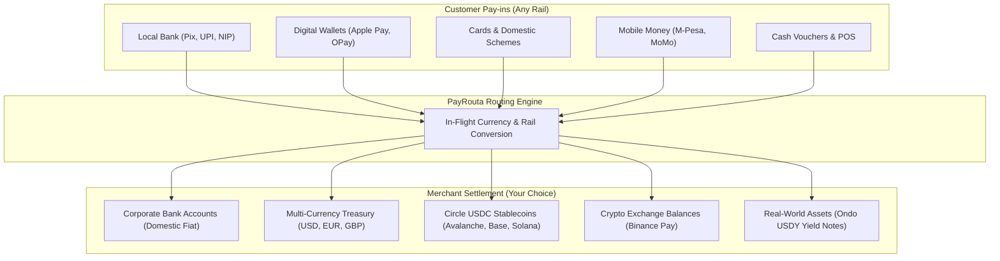

# Settlement & Treasury Management

Pay-in describes how the customer pays. Settlement describes how and where the merchant receives funds.

> [!NOTE]
> **Settlement is never fixed**: Merchants choose their preferred settlement method across any available rail, completely independent of how the customer paid. A business is never locked into the customer's currency or payment mechanism.

---

## Flexible merchant settlement options

Merchants can configure default settlement preferences by operating currency, legal entity, or transaction size:

### 1. Corporate domestic bank accounts
Settle directly into domestic commercial bank accounts via local instant and batch clearing rails:
* **Rails**: FedNow / ACH (US), Pix (Brazil), Faster Payments (UK), SEPA (Eurozone), NIP (Nigeria).
* **Benefits**: Funds land directly in operating bank accounts with domestic reconciliation references.

### 2. Multi-currency treasury balances
Retain received customer payments in their original currencies without forced foreign exchange conversion:
* **Supported Currencies**: USD, EUR, GBP, NGN, BRL, JPY, SGD.
* **Benefits**: Avoid unnecessary FX spreads and hedge against local currency volatility.

### 3. Stablecoins (Circle USDC)
Disburse settled funds directly into enterprise crypto custody wallets:
* **Supported Blockchains**: Avalanche (C-Chain), Base, Solana, Ethereum, Polygon PoS, Arbitrum One.
* **Benefits**: Near-instant finality, round-the-clock weekend clearing, and lower cross-border settlement fees.

### 4. Crypto exchange balances
Credit funds instantly into business exchange accounts such as **Binance Pay**:
* **Benefits**: Zero on-chain gas fees, immediate trading availability, and off-chain internal book transfers.

### 5. Real-World Assets (RWAs) & yield notes
Automatically allocate settled proceeds into tokenized cash equivalents and government treasury securities:
* **Supported Assets**: **Ondo Finance USDY** (yield-bearing short-term US Treasury note), **Franklin Templeton BENJI**, **Paxos Gold (PAXG)**.
* **Benefits**: Idle operating cash automatically accrues daily yield backed by high-quality US government debt.

---

## The two-phase settlement lifecycle

PayRouta strictly decouples order confirmation from physical settlement clearing:

| Phase | Event Name | Business Meaning | Recommended Merchant Action |
| :--- | :--- | :--- | :--- |
| **Phase 1: Confirmation** | `payment.confirmed` | Buyer has authorized payment; funds are irrevocably cleared. | **Fulfill order immediately.** Ship goods, provision digital access, or credit user accounts. |
| **Phase 2: Settlement** | `settlement.completed` | Funds have transferred to the merchant's chosen payout bank or treasury wallet. | **Reconcile ledger balance.** Financial accounts receive final fund movement. |

> [!WARNING]
> Do not withhold order fulfillment because settlement is pending. Traditional bank batches (e.g., ACH, Bacs) take 1 to 2 business days to clear, while payment confirmation occurs in real time.

---

## Multi-entity and split settlements

Enterprise merchants can configure split routing rules:
* **Regional Entities**: Route EUR payments to European subsidiaries and USD payments to US entities.
* **Treasury Diversification**: Automatically allocate 70% to local operating accounts and 30% to yield-bearing Circle USDC or Ondo USDY.
* **Marketplace Payouts**: Deduct platform processing commissions and route the remainder to third-party seller accounts.

---

## Reconciliation and reporting

Every transaction generates unified reconciliation identifiers:
* `payment_id`: Tracks the customer's payment initiation and authorization.
* `settlement_id`: Tracks the payout batch, exchange rate (if conversion occurred), and destination reference.
* `reconciliation_code`: An immutable identifier linking bank statement narrative or blockchain transaction hash (`tx_hash`) back to the original order.

---

## Next steps

* Review event schemas in [Webhooks & Events](webhooks.md).
* See endpoint parameters in [API Reference](api-reference.md).
* Learn about edge cases in [Errors & Recovery](errors.md).
