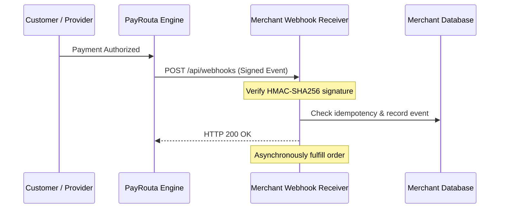

# Webhooks & Events

Asynchronous webhooks notify your backend when transaction and settlement states change across clearing networks. Because payment methods clear at different speeds, webhooks are essential for real-time order fulfillment.

> [!NOTE]
> Webhook endpoints must be publicly accessible via **HTTPS** and respond with a `2xx` HTTP status code within **5 seconds** to avoid automatic retry backoff.

---

## Event delivery lifecycle



---

## Supported event types

| Event Type | Description |
| :--- | :--- |
| `payment_intent.created` | Intent registered with invoice requirements. |
| `payment_intent.method_selected` | Customer selected a payment rail and provider. |
| `payment.processing` | Transaction submitted to clearing network or bank. |
| `payment.confirmed` | **Funds irrevocably authorized.** Order should be fulfilled immediately. |
| `payment.failed` | Transaction declined or authorization expired. |
| `settlement.processing` | Treasury transfer initiated to merchant account. |
| `settlement.completed` | **Funds received in merchant payout account or wallet.** |
| `settlement.delayed` | Banking cutoff or liquidity delay occurred. |

---

## Verifying webhook signatures

PayRouta signs all webhook payloads with an HMAC SHA-256 signature passed in the `PayRouta-Signature` header. Always verify the signature using your secret webhook signing key before processing the payload:

```typescript
import crypto from "node:crypto";

export function verifyWebhookSignature({
  rawBody,
  signatureHeader,
  webhookSecret,
}: {
  rawBody: string;
  signatureHeader: string;
  webhookSecret: string;
}): boolean {
  const [timestampPart, sigPart] = signatureHeader.split(",");
  const timestamp = timestampPart.split("=")[1];
  const signature = sigPart.split("=")[1];

  // Prevent replay attacks (reject events older than 5 minutes)
  const currentTime = Math.floor(Date.now() / 1000);
  if (Math.abs(currentTime - parseInt(timestamp, 10)) > 300) {
    return false;
  }

  const payloadToSign = `${timestamp}.${rawBody}`;
  const expectedSignature = crypto
    .createHmac("sha256", webhookSecret)
    .update(payloadToSign, "utf8")
    .digest("hex");

  return crypto.timingSafeEqual(
    Buffer.from(signature, "hex"),
    Buffer.from(expectedSignature, "hex")
  );
}
```

---

## Idempotency and deduplication

Network conditions can cause duplicate webhook deliveries:
1. Extract `event_id` from the payload.
2. Check your database for whether `event_id` has already been processed.
3. If already processed, immediately return `200 OK` without duplicating fulfillment or shipment.

---

## Out-of-order updates

Distributed networks and mobile telcos may deliver events out of sequence (for instance, receiving `payment.confirmed` before `payment.processing`, or delayed webhook retries).

* **Monotonic States**: Never allow an event with an older timestamp to revert an order from `confirmed` back to `processing`.
* **State Verification**: If a received event conflicts with your internal state, query the authoritative status endpoint (`GET /v1/payment_intents/:id`) before modifying business records.

---

## Illustrative webhook payload

```json
{
  "event_id": "evt_01j8m2k9p3",
  "event": "payment.confirmed",
  "created_at": "2026-09-14T01:31:00Z",
  "data": {
    "intent_id": "pi_01j8k9m2x",
    "merchant_reference": "order_eu_88192",
    "amount": "250.00",
    "currency": "EUR",
    "payment_method": "sepa_instant",
    "provider_reference": "SCT-INST-DE-99201",
    "settlement_status": "processing"
  }
}
```

---

## Next steps

* Learn about decoupled payout timing in [Settlement & Treasury](settlement.md).
* Handle edge cases and timeouts in [Errors & Recovery](errors.md).
* Review endpoint details in [API Reference](api-reference.md).
