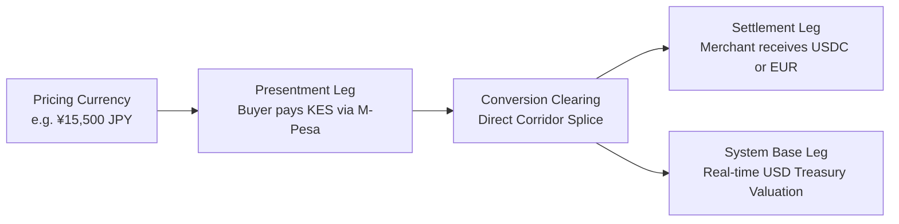

Traditional payment architectures force every cross-border transaction through a single base currency (such as USD), compounding foreign-exchange spreads on both legs. PayRouta's Unified Value Engine (`lib/payments/fx-splicing.ts` and `lib/payments/journal.ts`) treats **fiat currencies**, **mobile-money wallets**, and **stablecoins** as equal database primitives using exact integer minor-unit arithmetic (`BigInt`) and $10^{12}$-scaled fixed-point exchange rates.



## Triple-Entry Accounting

Every spliced transaction records three currency valuations simultaneously:

| Leg | Purpose | Example (`JPY` $\rightarrow$ `KES` $\rightarrow$ `USDC`) |
| --- | --- | --- |
| **Presentment Currency** | What the buyer actually paid in their local rail | `1292580` minor `KES` (`12,925.80 KES` via M-Pesa) |
| **Settlement Currency** | What the merchant receives into their wallet or bank account | `9795` minor `USDC` (`97.95 USDC` on Solana/Base) |
| **System Base Currency (`USD`)** | Simultaneous real-time USD valuation for treasury, reserve, and limit tracking | `10000` minor `USD` (`100.00 USD`) |

## Any-to-Any FX Splicing Engine

`createSpliceQuote` quotes direct and single-hop synthetic crosses across 25+ fiat and digital assets (`USD`, `EUR`, `GBP`, `JPY`, `NGN`, `KES`, `GHS`, `ZAR`, `BRL`, `MXN`, `INR`, `IDR`, `CAD`, `AUD`, `SGD`, `CHF`, `AED`, `XOF`, `XAF`, `UGX`, `RWF`, `USDC`, `USDT`, `EURC`, `PYUSD`) without forcing a double USD conversion spread:

```ts
import { createSpliceQuote, postSplicedCollection } from "@/lib/payments/fx-splicing";

// European merchant prices software in JPY, Kenyan buyer pays via M-Pesa (KES),
// and the merchant settles directly into USDC on Solana or EUR via SEPA.
const quote = createSpliceQuote({
  pricingCurrency: "JPY",
  pricingAmountMinor: 15_500n,
  presentmentCurrency: "KES",
  presentmentRail: "MPESA",
  settlementCurrency: "USDC",
  settlementNetwork: "solana",
  providerFeeBps: 150,
  platformFeeBps: 50,
});
```

### Rate Freshness & Fail-Closed Guardrails

- Every corridor rate in `FxRateBook` carries a cryptographic `rateId`, $10^{12}$-scaled `majorRateScaled`, `spreadBps`, `quotedAt`, and `expiresAt`.
- If a quote or rate snapshot has expired at the time of checkout or ledger posting, `createSpliceQuote` and `postSplicedCollection` fail closed with `FX_RATE_EXPIRED` or `FX_QUOTE_EXPIRED_AT_POSTING`.

## Atomic Cross-Currency Journal Postings

When `postSplicedCollection` executes inside a PostgreSQL transaction, it writes balanced double-entry legs across `books["provider-merchant-operational"]` and `books["payrouta-platform-accrual"]`:

1. **Presentment Leg** (`asset: presentmentCurrency`):
   - Debit `provider-clearing` / Credit `conversion-clearing`
2. **Settlement Leg** (`asset: settlementCurrency`):
   - Debit `conversion-clearing` / Credit `merchant-payable` (net) + Credit `provider-fee` (total fee)
3. **Platform Accrual Leg** (`book: "payrouta-platform-accrual"`, `asset: settlementCurrency`):
   - Debit `platform-receivable` / Credit `platform-fee-revenue`

Each journal entry's `purpose` carries a lossless `TRIPLE_LEDGER` stamp (`encodeTripleEntryPurpose` / `decodeTripleEntryPurpose`) preserving the exact presentment, settlement, and USD base figures for audit and reconciliation.
