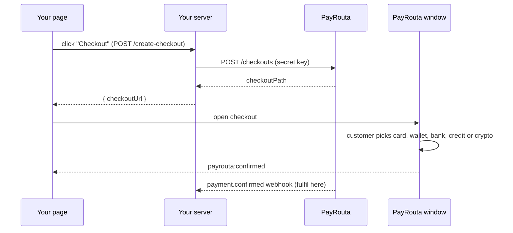

<Note>
Stablecoin and crypto checkout work for every account. Cards, digital wallets, bank transfers and mobile money appear as they open for your account and region; credit appears where a lender is available.
</Note>



## 1. Create checkouts on your server

Call [`POST /checkouts`](/api-reference/introduction) with your secret key and return the link. One call covers every fiat method you list and, for USD orders, crypto.

```ts
const checkout = await payrouta.createCheckout(
  {
    reference: order.id,
    payerCountry: order.country,
    amount: order.total,
    currency: "USD",
    methods: ["card", "digital-wallet", "bank-transfer", "mobile-money", "bnpl"],
    crypto: { options: [{ network: "eip155:8453", identifier: "erc20:0x833589fcd6edb6e08f4c7c32d4f71b54bda02913" }] },
    returnUrl: `https://shop.example/orders/${order.id}`,
  },
  `order-${order.id}`,
);
return { checkoutUrl: new URL(checkout.checkoutPath, PAYROUTA_ORIGIN).href };
```

The return URL must be on your registered return origin.

## 2. Add the button

<Tabs>
  <Tab title="HTML">
    ```html
    <script src="https://<your PayRouta host>/js/v1/payrouta.js" async></script>
    <button data-payrouta-checkout="/create-checkout">Checkout</button>
    ```

    The attribute names your endpoint. Add `data-payrouta-mode="redirect"` to open checkout in the same tab instead of a window.
  </Tab>
  <Tab title="React">
    ```tsx
    import { PayRoutaButton } from "@payrouta/checkout";

    <PayRoutaButton
      origin="https://<your PayRouta host>"
      session="/create-checkout"
      onEvent={(name) => name === "confirmed" && refreshOrder()}
    >
      Checkout
    </PayRoutaButton>;
    ```
  </Tab>
  <Tab title="JavaScript">
    ```js
    button.addEventListener("click", () =>
      PayRouta.checkout({ session: "/create-checkout", onEvent: (name, detail) => console.log(name, detail) }),
    );
    ```

    Call it inside the click so the browser allows the window. `session` can also be a function that returns the checkout URL.
  </Tab>
</Tabs>

## 3. Handle the outcome

| Event | When |
| --- | --- |
| `payrouta:open` | The secure window opened |
| `payrouta:pending` | The provider is still confirming, for example a bank transfer |
| `payrouta:confirmed` | Payment confirmed; `detail.returnUrl` and `detail.reference` |
| `payrouta:closed` | The customer closed the window or returned without paying |
| `payrouta:error` | Your endpoint failed or returned an invalid link |

By default `confirmed` sends the page to the return URL; call `event.preventDefault()` to stay on the page.

<Warning>
Browser events are not proof of payment. Fulfil orders only from the signed `payment.confirmed` [webhook](/integrate/webhooks) or `GET /payments/{id}`.
</Warning>

## Security

- The script only opens PayRouta's own `/checkout/` pages on the origin it was loaded from, or the one named with `data-payrouta-origin`.
- Checkout runs in a top-level PayRouta window, never an iframe on your page, so wallets, 3-D Secure and lender approval pages work and PayRouta's cookies stay first-party.
- Checkout reports back with `postMessage` to your return URL's origin only. Messages carry no secrets.
- If the browser blocks the window, checkout takes over the tab and returns to your return URL.
