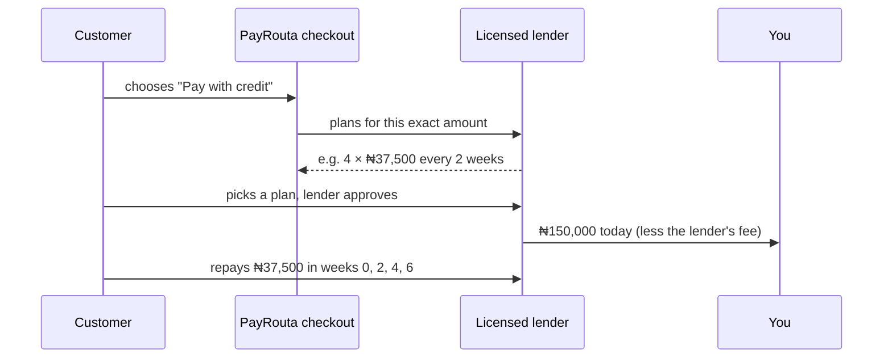

Most payment companies compete on how many ways a customer can pay. In much of the world the harder problem is affordability: few people have a credit card, so a phone, a laptop or a year of software is out of reach in one payment. PayRouta puts credit inside the checkout as one more way to pay.

<Note>
Built and testable end to end in sandbox with a fictional lender. Live credit opens country by country as licensed lenders join PayRouta. No lender is live yet.
</Note>

## Who pays whom



A missed repayment is between the customer and the lender. It never comes back to you, and PayRouta never lends.

## Offer it

Add `bnpl` ("Pay with credit") to your checkout's `methods`, next to the other ways to pay:

```json
{ "methods": ["card", "digital-wallet", "bank-transfer", "mobile-money", "bnpl"] }
```

Checkout shows credit only where a lender lends to the customer's country (`payerCountry`) and offers a plan for the amount.

## What customers see

<Steps>
  <Step title="Every plan, for this amount">
    Number of payments, how often, what's due today, each payment, the total repaid, the cost of credit, and the APR where the lender quotes one. When the total doesn't divide evenly, the first payment is shown separately.
  </Step>
  <Step title="The lender's name and terms">
    The customer enters a credit agreement with the lender, not with you or PayRouta, so the lender is named before they agree.
  </Step>
  <Step title="Approval by the lender">
    The lender checks eligibility on its own pages. A decline leaves the checkout open for another method.
  </Step>
</Steps>

## Subscriptions on credit

Sell the term upfront and let the customer repay monthly: create the checkout for the term price, for example a 12-month plan, and fulfil the term when the payment is confirmed. You are paid the whole term today.

## Fees

PayRouta's usual fee for partner-processed payments (1%, max $5) plus the lender's merchant fee, which each lender sets and PayRouta shows you before you enable it. See [fees](/concepts/billing).

## Test in sandbox

Ask PayRouta to connect your sandbox business to **Sandbox Credit (fictional lender)**. Plans for any amount from 10.00 to 5,000,000.00 in the payment currency:

| Plan | Payments | Cost of credit |
| --- | --- | --- |
| `sbxc-p4` | 4, every two weeks, first one today | none |
| `sbxc-pl30` | 1, in 30 days | none |
| `sbxc-m3` | 3, monthly | 4.5% |
| `sbxc-m6` | 6, monthly (from 50,000.00) | 12% |

Approve the test credit on the checkout to confirm the payment. A `reference` containing `[decline]` is declined, so you can test that path.

## For lenders

Licensed lenders and consumer-credit providers connect as PayRouta platform modules. A credit module:

- declares `methods: ["bnpl"]` and a `credit` disclosure: legal lender name, terms URL, and the countries it lends to;
- answers `creditOffers({ amount, precision, currency, payerCountry })` with its plans for that amount, using PayRouta's shared plan arithmetic so every lender's plans read the same;
- accepts `createPayment` with `credit: { offerId }`, re-prices the plan and refuses if it no longer offers it;
- sends the customer to its own approval pages, reports approval through `paymentStatus`, and reports paying the merchant through `fundsAvailability`.

Credit risk, affordability checks and consumer-credit disclosures are the lender's, under its licence. To become a credit partner, request access on PayRouta's partners page and choose "Lender / consumer-credit provider".
