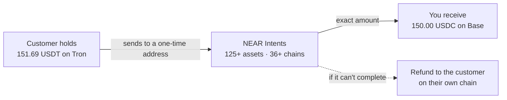

<Note>
Live on production checkouts, next to paying straight from a wallet on eight networks ([crypto wallet payments](/guides/crypto-payments)). NEAR Intents has no testnet, so sandbox checkouts don't show it.
</Note>

Your crypto checkout asks for, say, 150.00 USDC on Base. A customer holding USDT on Tron, SOL, BTC or anything else NEAR Intents supports can still pay. [NEAR Intents](https://docs.near-intents.org) is a universal liquidity layer that supports over 125 assets across 36+ blockchain networks, including Bitcoin, Ethereum, Solana, Tron, BNB Chain, TON, Base, Arbitrum, Polygon, Avalanche and Stellar.

## How it works

<Steps>
  <Step title="Customer picks what they hold">
    Under the deposit instructions, **Pay from another chain or token**: a network, a token, and their own address on that network for refunds.
  </Step>
  <Step title="PayRouta gets an exact-output quote">
    Through NEAR Intents' 1Click API: deliver exactly your invoice amount to your receive address for this payment. PayRouta only shows a quote whose guaranteed output equals the invoice; anything else is refused.
  </Step>
  <Step title="Customer sends to a one-time address">
    From any wallet or exchange. The swap cost is inside the quoted amount, so you receive the full invoice.
  </Step>
  <Step title="Confirmed on-chain">
    Exactly as for a direct transfer: when the exact amount reaches your receive address before the quote deadline and is final.
  </Step>
</Steps>

Neither PayRouta nor NEAR Intents holds the funds along the way.

## What you can receive

| Your checkout asks for | Payable from any NEAR Intents asset |
| --- | --- |
| USDC on Base, Ethereum, Arbitrum, Polygon, Avalanche, Solana or Stellar | Yes |
| USDT on Ethereum, Avalanche or Solana | Yes |
| EURC, or volatile coins such as ETH and SOL | Not yet: volatile-coin quotes last two minutes, too short for a swap |

## Limits

- No single minimum: each asset, pair and network has its own, usually a USD floor set by NEAR Intents' solvers, and it changes over time. Below it, checkout tells the customer to try another token or chain, or pay directly.
- NEAR Intents' protocol fee starts at 1 basis point (0.01%) for stablecoin and matching multichain pairs; partner API tiers can set a minimum fee on other pairs. Swap costs are inside the customer's quoted amount, so you receive the full invoice.
- Quotes need at least five minutes left on the checkout.
- A live dry-run quote on 20 October 2026 confirmed the behaviour PayRouta relies on: for 150 USDC on Base from USDT on Tron, the quoted and minimum output were both exactly 150.000000 USDC, for an input of 151.69 USDT and an estimated 82 seconds.

## Operations

It is on by default; set `CROSS_CHAIN_PAYMENTS=off` to turn it off. Store a 1Click partner API key in the vault with its reference in `ONECLICK_API_KEY_REF`; without a key, 1Click adds a small fee to each swap. Destination tokens are pinned in PayRouta and re-checked against NEAR Intents' live token list before every quote.
