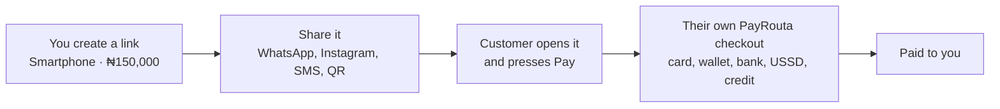

<Steps>
  <Step title="Create the link">
    In your dashboard, open **Payment links**. Enter what it's for, the amount and currency, and the country most of your customers are in.
  </Step>
  <Step title="Choose the ways to pay">
    Card, digital wallets, bank transfer, mobile money, USSD, [pay with credit](/guides/credit), and stablecoins for USD links.
  </Step>
  <Step title="Share it">
    Copy the link or send it straight to WhatsApp. One link takes any number of payments.
  </Step>
</Steps>

<Tip>
Opening a link creates nothing. A checkout is made only when the customer presses **Pay**, so chat-app link previews are safe.
</Tip>

## What customers see

Your business name, what they're paying for and the amount, then PayRouta checkout. Credit plans follow the customer's own country when PayRouta can tell where they are, otherwise the country you chose.

## After payment

Customers land on a PayRouta thank-you page. The payment shows under **Transactions** with the link's name as its reference, and [webhooks](/integrate/webhooks) fire as usual.

## Turning a link off

Turn a link off on the same page when you stop selling the item. You can turn it back on later.
