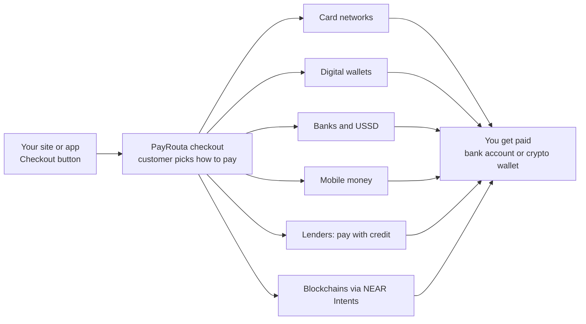

Share a payment link or add one checkout button to your site or app. Your customers pay with whatever they have, and where they can't pay all at once, they spread the cost with a licensed lender while you are paid in full.

<Info>
Stablecoin and crypto payments are live. Cards, digital wallets, bank transfers and mobile money open region by region. Paying from any chain through NEAR Intents is live. Credit opens country by country as licensed lenders join.
</Info>

## Start here

<CardGroup cols={2}>
  <Card title="Payment links" icon="link" href="/guides/payment-links">
    No website? Share a link on WhatsApp, Instagram or SMS.
  </Card>
  <Card title="Add the checkout button" icon="square-check" href="/guides/checkout-button">
    One script tag and a button, or a React component. Every method in one window.
  </Card>
  <Card title="Quickstart" icon="rocket" href="/quickstart">
    Create a test checkout and take a payment in a few minutes.
  </Card>
  <Card title="Pay with credit" icon="calendar" href="/guides/credit">
    Instalments from licensed lenders across 5 continents. You are paid in full; the lender carries the risk.
  </Card>
  <Card title="Pay from any chain" icon="shuffle" href="/guides/cross-chain">
    125+ assets across 36+ chains, delivered as the exact coin you asked for.
  </Card>
  <Card title="Localized Checkout & Global Tax" icon="globe" href="/guides/localization-and-tax">
    Context-aware regional payment rails plus real-time EU VAT, US Sales Tax, Canadian GST/HST, and global Indirect Tax.
  </Card>
</CardGroup>

## Ways customers pay

| Method | What customers use |
| --- | --- |
| Cards | Visa, Mastercard, American Express, Verve and local schemes |
| Digital wallets | Apple Pay, Google Pay, PayPal and local wallets |
| Bank transfer | Bank apps, pay by bank, Pix, UPI, NIP |
| Mobile money | M-Pesa, MTN MoMo, Airtel Money |
| USSD | A short code, no data needed |
| Pay with credit | A licensed lender's instalment plan, priced for the exact amount |
| Stablecoins and crypto | USDC, USDT, EURC and major coins from any wallet; any token on any chain through NEAR Intents |

Which methods a customer sees depends on your account and their country. See [payment methods](/concepts/payment-methods) for the full list and status.

## Sell where you already sell

<CardGroup cols={2}>
  <Card title="No website" icon="message" href="/guides/payment-links">
    A payment link you share anywhere.
  </Card>
  <Card title="Any website or app" icon="code" href="/guides/checkout-button">
    One script tag and a button.
  </Card>
  <Card title="Shopify" icon="shopify" href="/platforms/shopify">
    A payments app at Shopify checkout.
  </Card>
  <Card title="WooCommerce" icon="wordpress" href="/platforms/woocommerce">
    The PayRouta Checkout plugin.
  </Card>
</CardGroup>

## How PayRouta handles your money

You apply once. PayRouta verifies your business and sets up processing with licensed partners and lenders in each region. Balances sit with those regulated partners, never in PayRouta's own bank accounts, and stablecoin payments go straight to your own wallet. If a partner fails before charging, the same payment goes through another, never twice. See [settlement](/concepts/settlement) and [fees](/concepts/billing).
