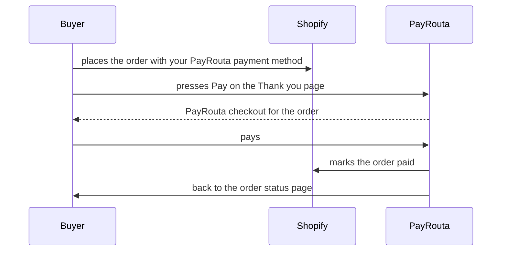

Buyers choose PayRouta at checkout, place the order, and pay from a **Pay** button on the Thank you and order status pages, by card, digital wallet, bank transfer, mobile money, credit from a licensed lender or, for USD stores, stablecoins and crypto from any wallet. PayRouta marks the order paid in Shopify once the payment is confirmed.

## Before you start

- A PayRouta business. A business in test mode pairs with a Shopify development store; a live store needs a live PayRouta business.
- Owner or admin access to your Shopify store and to your PayRouta business.

## Set up

<Steps>
  <Step title="Connect your store">
    In PayRouta, open **Developers → Integrations**. Enter your `*.myshopify.com` address, the name your payment method will have in Shopify, and how long unpaid orders stay open. Choose **Connect Shopify** and approve the app in Shopify.
  </Step>
  <Step title="Add the payment method">
    In Shopify, open **Settings → Payments**. Under **Manual payment methods**, choose **Create custom payment method** and give it exactly the name you entered in PayRouta, for example `PayRouta`. See Shopify's guide to [manual payment methods](https://help.shopify.com/en/manual/payments/manual-payments).
  </Step>
  <Step title="Add the Pay button">
    Open **Settings → Checkout** and choose **Customize**. Switch to the **Thank you** page, add the **PayRouta Pay now** app block, and save. Do the same on the **Order status** page.
  </Step>
  <Step title="Place a test order">
    See [Testing your setup](#testing-your-setup).
  </Step>
</Steps>

## What buyers see

1. At checkout, the buyer chooses your PayRouta payment method and places the order.
2. The Thank you page shows **Pay** with the order total. It opens a PayRouta checkout for that order.
3. After paying, the buyer returns to the order status page, and the order is marked paid.

A buyer who leaves without paying can pay later from the order status page, until the order is cancelled.

## Unpaid orders

Orders placed with your PayRouta payment method stay **Payment pending** until paid. When the time you chose in PayRouta passes (24 hours to 7 days, or never), PayRouta cancels the order, restocks its items and notifies the buyer. An order with a payment still in progress is cancelled only if that payment doesn't complete. Orders you mark paid yourself are left alone.

If you edit an order after the buyer opened its checkout, PayRouta doesn't mark it paid. Settle the difference with the buyer and mark the order paid in Shopify.

## Refunds

Refund from the PayRouta dashboard under **Transactions**, then record the refund on the order in Shopify. Crypto payments are refunded from your own wallet.

## Testing your setup

<Steps>
  <Step title="Connect a development store">
    Connect a Shopify development store to your PayRouta business in test mode, as above.
  </Step>
  <Step title="Place an order">
    Check out on your store with your PayRouta payment method.
  </Step>
  <Step title="Pay">
    On the Thank you page, press **Pay** and complete the test payment. No real money moves.
  </Step>
  <Step title="Check both sides">
    The order shows as paid in your Shopify admin, and the payment appears in PayRouta under **Transactions**.
  </Step>
</Steps>

Shopify's guide to [test orders](https://help.shopify.com/en/manual/checkout-settings/test-orders) covers deleting test orders afterwards.

## Troubleshooting

| What you see | What to check |
| --- | --- |
| No **Pay** button on the Thank you page | The payment method's name in Shopify matches the name in PayRouta exactly; the **PayRouta Pay now** block is added and the checkout is saved; the order isn't already paid. |
| "Payment isn't available right now" | The store is connected under **Developers → Integrations**, and a development store is connected to a business in test mode, a live store to a live business. |
| The order stays **Payment pending** after paying | The payment may still be confirming; crypto payments confirm once the network does. Check the payment in PayRouta under **Transactions**. |
| The order was edited after checkout opened | PayRouta leaves it for you. Settle the difference and mark it paid in Shopify. |

## Resources

- [Checkout button](/guides/checkout-button): the PayRouta checkout your buyers see
- [Webhooks](/integrate/webhooks): payment events for your own systems
- [Pay with credit](/guides/credit) and [Crypto payments](/guides/crypto-payments)
- Shopify: [manual payment methods](https://help.shopify.com/en/manual/payments/manual-payments), [test orders](https://help.shopify.com/en/manual/checkout-settings/test-orders)
