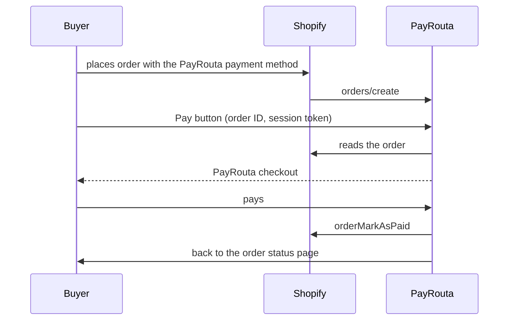

PayRouta works with Shopify in two ways. Both open a PayRouta checkout with every method you accept, including credit from licensed lenders and, for USD stores, stablecoins and crypto from any wallet.

| | Pay now | Payments app |
| --- | --- | --- |
| Buyer pays | After placing the order, from a Pay button on the Thank you and order status pages | Before the order is placed, from Shopify checkout |
| Order paid | `orderMarkAsPaid` once confirmed | `paymentSessionResolve` once confirmed |
| Unpaid orders | Cancelled after your deadline | Never created |

## Pay now

<Steps>
  <Step title="Connect your store">
    In PayRouta, open **Developers → Integrations**. Enter your `*.myshopify.com` address, the payment method's name, and how long unpaid orders stay open. Choose **Connect Shopify** and approve the app.
  </Step>
  <Step title="Add the payment method">
    In Shopify, open **Settings → Payments → Manual payment methods** and create a custom payment method with exactly that name.
  </Step>
  <Step title="Add the Pay button">
    Open **Settings → Checkout → Customize** and add **PayRouta Pay now** to the Thank you and order status pages.
  </Step>
  <Step title="Test">
    A store in test mode uses your PayRouta sandbox; a live store needs a live PayRouta business.
  </Step>
</Steps>

The button shows only for unpaid orders placed with your PayRouta payment method, and a signed-in customer only sees it on their own orders. An order with a checkout that can still be paid, or a payment still confirming, is cancelled only after it ends. An order whose total changes after its checkout opens is left for you to settle.

Refund from the PayRouta dashboard, then record the refund in Shopify.

## Payments app

<Steps>
  <Step title="Connect your store">
    In PayRouta, open **Developers → Integrations** and connect the payments app. Approve it in Shopify.
  </Step>
  <Step title="Activate PayRouta in Shopify">
    Shopify opens its payment settings. Turn PayRouta on.
  </Step>
</Steps>

Refunds made in Shopify are sent to PayRouta and refunded on the original method. Orders paid in crypto are refunded by you from your own wallet, and Shopify is told so.
