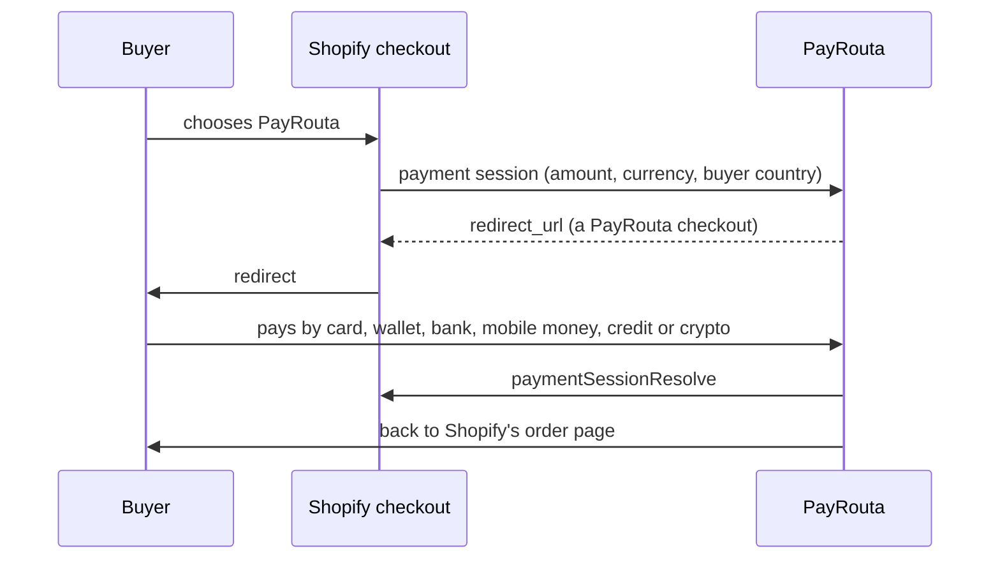

<Note>
Built and tested against Shopify's documented contracts; not yet run against a Shopify development store. Payments apps use restricted scopes, so Shopify must approve PayRouta as a payments partner before stores outside development can install it.
</Note>

## Set up

<Steps>
  <Step title="Connect your store">
    In PayRouta, open **Developers → Integrations**, enter your `*.myshopify.com` address and choose **Connect Shopify**. Approve the app in Shopify.
  </Step>
  <Step title="Activate PayRouta in Shopify">
    Shopify opens its payment settings. Turn PayRouta on.
  </Step>
  <Step title="Test">
    Shopify test mode uses your PayRouta sandbox. Test mode and sandbox must match; a live store needs a live PayRouta business.
  </Step>
</Steps>

## Refunds

Refunds made in Shopify are sent to PayRouta and refunded on the original method. Orders paid in crypto are refunded by you from your own wallet, and Shopify is told so.

## For operators

- **Mutual TLS.** Shopify calls the payment and refund session URLs with a client certificate. Run them on a dedicated host with `ssl_verify_client on` and Shopify's CA; nginx forwards the result and a proxy secret, and PayRouta refuses session requests without both. The main host returns 404 for those paths.
- **Configuration.** `SHOPIFY_API_KEY`, `SHOPIFY_API_SECRET_REF`, `SHOPIFY_API_VERSION` (default `2026-10`) and `SHOPIFY_MTLS_PROXY_SECRET_REF`.
- **Webhooks.** `app/uninstalled` and the mandatory compliance topics, verified with the app secret.
- **Idempotency.** Repeated session requests with the same Shopify ID return the same checkout. Buyer cancellations are never sent to Shopify as rejections.
