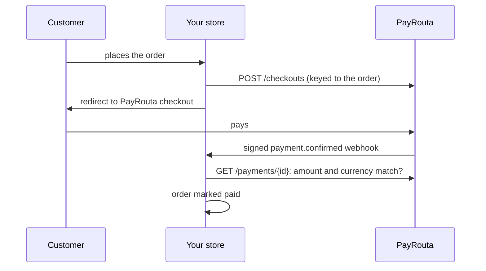

<Note>
0.1.0, run end to end in sandbox on WordPress 7.1 and WooCommerce 11.2. [Download the plugin](https://payrouta.com/downloads/payrouta-checkout.zip). Requires WordPress 6.4+, WooCommerce 8.2+ and PHP 7.4+; works with High-Performance Order Storage and the block checkout.
</Note>

## Set up

<Steps>
  <Step title="Install the plugin">
    [Download the plugin](https://payrouta.com/downloads/payrouta-checkout.zip), then upload and activate it under **Plugins → Add New**.
  </Step>
  <Step title="Create an API key">
    In PayRouta, set your return origin to the store's address and create a key with `payments:write` and `payments:read`.
  </Step>
  <Step title="Configure the plugin">
    **WooCommerce → Settings → Payments → PayRouta**: API URL (`https://<your PayRouta host>/api/v1/`), environment and secret key. Choose the methods to offer: cards, digital wallets, bank transfer, mobile money, USSD, direct debit and pay with credit. For USD stores, list crypto as `network|identifier` lines.
  </Step>
  <Step title="Connect the webhook">
    In PayRouta **Developers → Webhooks**, set the endpoint to `https://YOUR-STORE/wp-json/payrouta/v1/webhook` with a key ID and secret, and enter the same values in the plugin.
  </Step>
</Steps>

## When an order is marked paid

Only after a signed `payment.confirmed` webhook arrives **and** the plugin reads the payment back from the API and the amount and currency match the order. A confirmed payment that doesn't match puts the order on hold for review. Returning from checkout alone never marks an order paid.

## Refunds

Refund from the PayRouta dashboard. Refunding from WooCommerce isn't supported in 0.1.0.
